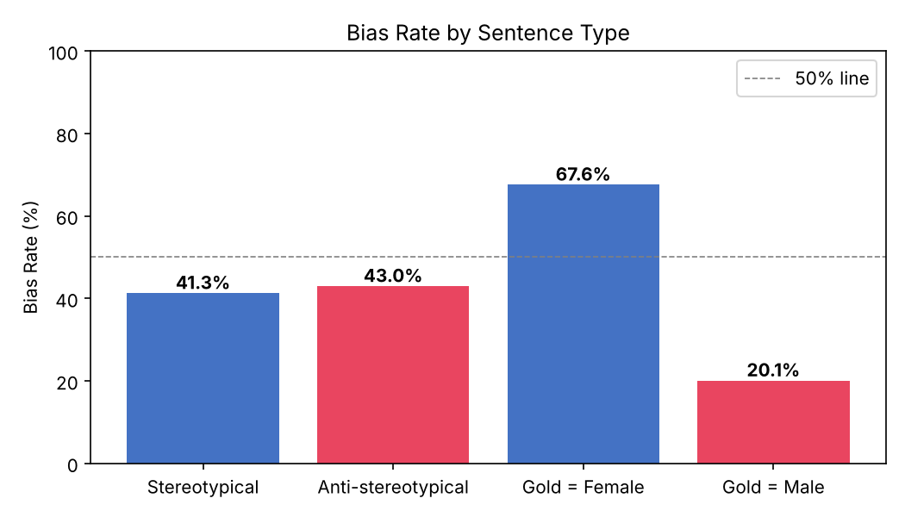
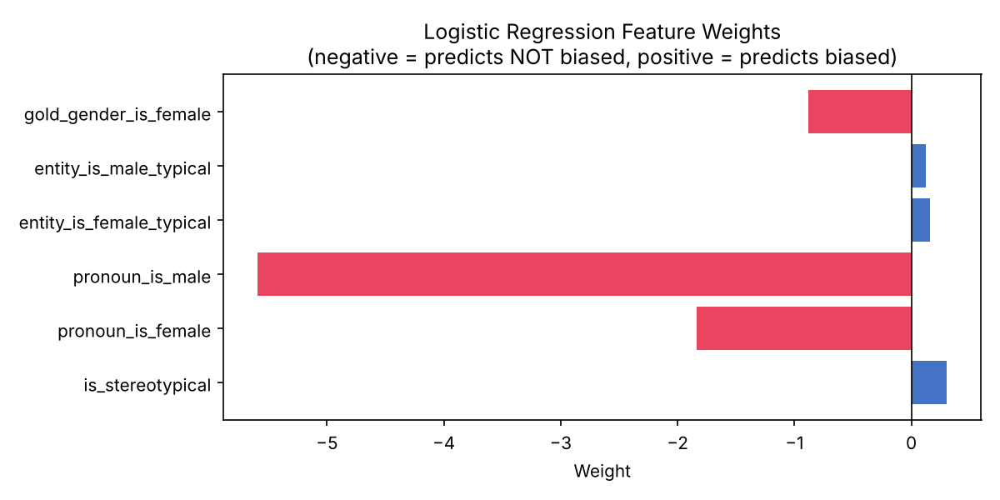

# Predicting Gender Bias in Machine Translation


## What this project does

English often doesn't mark a person's gender ("the developer", "the nurse"), but Spanish has to. So when Google Translate turns an English sentence into Spanish, it has to pick one, and sometimes it picks wrong. I wanted to see if I could predict, just from the English sentence, when that would happen.

I used the WinoMT benchmark: 3,888 English sentences, each about a person whose gender is given by a pronoun. The script `run_project.py` does the following:

1. Translates every sentence into Spanish with Google Translate. The translations are saved in `data/translated_es.csv`, so the API doesn't need to be called again.
2. Looks at the Spanish articles and word endings (el/la, un/una, -o/-a) to guess which gender the translation used, and marks the sentence as biased if it doesn't match the pronoun.
3. Turns each English sentence into 6 yes/no features, such as whether the pronoun is male or female and whether the job is usually thought of as a "male" or "female" job.
4. Trains a logistic regression model on 80% of the sentences and tests it on the other 20%.

## Results

The model got 82.4% accuracy on the test set (precision 84.2%, recall 82.4%, F1 82.5%).

The clearest pattern was about gender, not stereotypes. When the person in the sentence was a woman, the translation got the gender wrong 67.6% of the time, compared with 20.1% for the other sentences. Stereotypical and anti-stereotypical sentences had almost the same error rate (41.3% vs. 43.0%), which I didn't expect. The pronoun features had the largest weights in the model.





## How to run

```
pip install -r requirements.txt
python run_project.py
```

It uses the cached translations, so it finishes in a few seconds. Charts and a short summary are saved to `results/`.

## Known issues and what I'd change

- The gender check reads the first gendered word in the Spanish sentence. But in many WinoMT sentences the person we care about is the second noun (for example, "The developer argued with the designer because his idea cannot be implemented" is about the designer), so some labels describe the wrong person. Aligning the English word to its Spanish translation, like the original WinoMT paper does, would fix this.
- Some WinoMT sentences use a gender-neutral pronoun. My check can only return male or female, so these sentences always count as biased. This raises the error rate for the "other sentences" group and the weight of the pronoun features.

## Note on AI use

The Spanish rules for detecting gender (checking articles like el/la and word endings) were designed with help from AI, because I don't speak Spanish and couldn't check the rules myself. Everything else, including the research question, features, model choice, evaluation and analysis, was done by me.

## Data

WinoMT (Stanovsky et al., 2019), built from Winogender (Rudinger et al., 2018) and WinoBias (Zhao et al., 2018).
